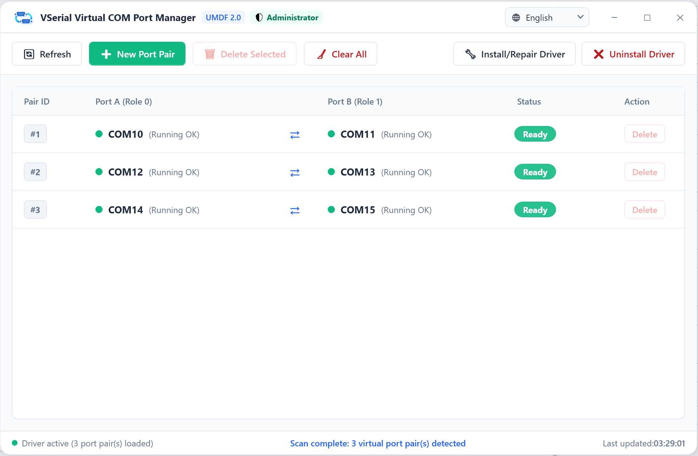
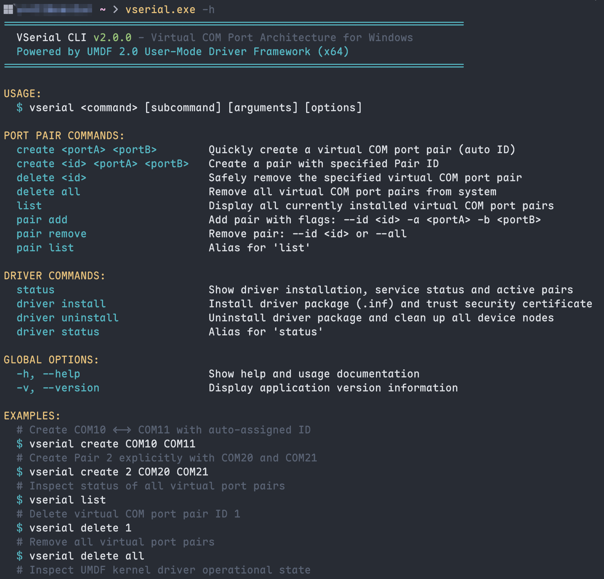

<div align="center">


# VSerial

Virtual COM port pair system for Windows 10 and 11, built on UMDF 2.0.

[](https://microsoft.com/windows)
[](https://learn.microsoft.com/en-us/windows-hardware/drivers/wdf/overview-of-the-umdf)
[](https://dotnet.microsoft.com/)
[](LICENSE)
[](https://github.com)

[English](README.md) | [简体中文](README_zh.md)

</div>

---

## Overview

VSerial creates virtual COM port pairs (e.g. `COM10` <-> `COM11`) on Windows. Data written to one port is immediately available to read from the other, with full hardware flow control signal mapping (RTS/CTS, DTR/DSR/DCD).

It includes:
- **GUI** (`vserial-gui.exe`): A desktop application for viewing and managing port pairs.
- **CLI** (`vserial.exe`): A command-line tool for scripting and automated environments.
- **UMDF 2.0 Driver**: A user-mode driver that runs in user space rather than the Windows kernel.

---

## Background

For years, [com0com](https://sourceforge.net/projects/com0com/) was the standard utility for virtual serial ports on Windows. However, running it on modern Windows 10 and 11 presents practical issues:

1. **Kernel Driver Stability**: com0com runs as a legacy kernel-mode driver (KMDF 0.9 / Ring 0). Unexpected concurrency or buffer states can cause a system crash (BSOD).
2. **Driver Signature Enforcement**: Its driver signatures frequently conflict with UEFI Secure Boot and modern Windows driver policies, causing installation failures.
3. **Small Buffer Size**: The default 1 KB buffer easily overflows during continuous high-baud-rate or burst transmissions.
4. **Maintenance**: Upstream development has been inactive for an extended period.

VSerial addresses these issues by using Microsoft's **User-Mode Driver Framework 2.0 (UMDF 2.0)**. The driver executes inside the user-mode driver host process (`WUDFHost.exe`), isolating any driver faults from the OS kernel. The in-memory buffer is expanded to **64 KB** per direction, and ports can be added or removed dynamically without restarting the system.

---

## Features

- **In-Memory Null-Modem Emulation**: Direct memory transfer between paired ports with standard serial event support (`WaitCommEvent`).
- **Hardware Flow Control**: Interlocked signal lines (RTS <-> CTS, DTR <-> DSR/DCD).
- **64 KB Ring Buffer**: Bi-directional buffer to prevent overruns under high baud rates.
- **Crash-Resistant**: Runs under UMDF 2.0 in user space; cannot crash the Windows kernel.
- **Dynamic Device Management**: Add, query, and remove ports at runtime via Windows SetupAPI and CfgMgr32.
- **Management Options**: WPF desktop interface (with English/Chinese localization) and scriptable console CLI.

---

## Screenshots

### Desktop GUI


### Command-Line Interface


---

## Installation

Download the installer package from [Releases](https://github.com):

- **Installer** (`VSerial-Setup-v1.0.0-x64.exe`): Installs the driver, desktop app, and configures system `PATH`.

> Note: Releases only provide the installer package. If you require a portable standalone zip, build it from source using `pwsh -File .\scripts\build_release.ps1 -BuildPortable`.

---

## CLI Usage

> Note: Hardware management requires an elevated terminal (Run as Administrator).

### Add a port pair
```cmd
vserial.exe pair add --id 1 --portA COM10 --portB COM11
```

### List port pairs
```cmd
vserial.exe pair list
```

### Remove a port pair
```cmd
vserial.exe pair remove --id 1
```

---

## Testing

A Python test script is available in `tests/test_serial_pair.py`:

```bash
pip install pyserial
python tests/test_serial_pair.py --portA COM10 --portB COM11
```

The script verifies:
- Bidirectional full-duplex text transmission
- 64 KB binary throughput and MD5 integrity
- RTS/CTS and DTR/DSR flow control state transitions

---

## Building from Source

### Requirements
- **Visual Studio 2022** (v143 toolset with Spectre-mitigated libs)
- **Windows SDK & WDK**: `10.0.26100.0`
- **.NET 8.0 SDK**
- **Inno Setup 6** (optional, for installer build)

### Build Script
```powershell
# Default: build driver, publish CLI/GUI, and create installer package
pwsh -File .\scripts\build_release.ps1

# Include portable zip package:
pwsh -File .\scripts\build_release.ps1 -BuildPortable

# Custom version override (defaults to Directory.Build.props):
pwsh -File .\scripts\build_release.ps1 -Version 2.1.0
```

Artifacts are placed in the `dist/` directory.

---

## License

[MIT](LICENSE)
