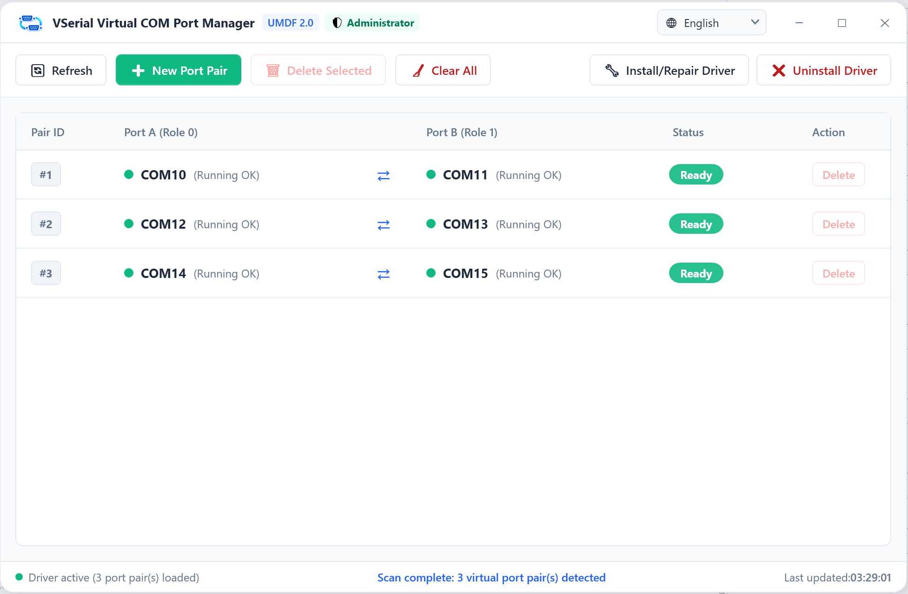
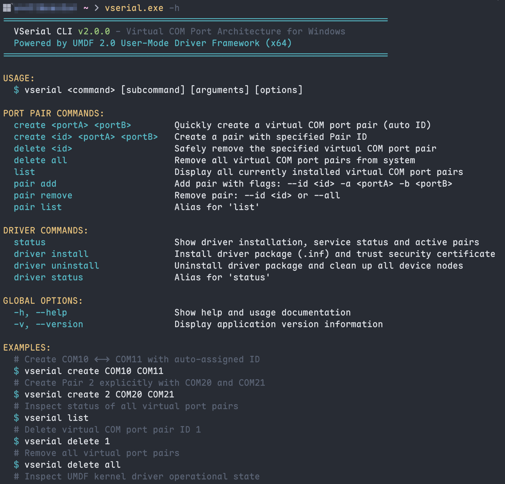

<div align="center">


# VSerial

基于 UMDF 2.0 的 Windows 10/11 成对虚拟串口系统。

[](https://microsoft.com/windows)
[](https://learn.microsoft.com/zh-cn/windows-hardware/drivers/wdf/overview-of-the-umdf)
[](https://dotnet.microsoft.com/)
[](LICENSE)
[](https://github.com)

[English](README.md) | [简体中文](README_zh.md)

</div>

---

## 概述

VSerial 能够在 Windows 系统中创建成对互通的虚拟串口（例如 `COM10` 与 `COM11`）。写入一端端口的数据可即时从另一端读取，并完整支持硬件流控信号（RTS/CTS、DTR/DSR/DCD）的联锁映射。

项目包含：
- **桌面图形界面** (`vserial-gui.exe`)：用于查看和管理虚拟串口对的 WPF 应用程序。
- **命令行工具** (`vserial.exe`)：用于脚本调用和无头环境管理的控制台程序。
- **UMDF 2.0 驱动**：运行于用户态空间的 Windows 驱动程序，隔离于系统内核之外。

---

## 背景

长期以来，[com0com](https://sourceforge.net/projects/com0com/) 是 Windows 下测试串口通信的经典工具。但在现代 Windows 10 和 11 系统上使用时，存在一些实际问题：

1. **内核驱动稳定性**：com0com 基于早期的 KMDF 0.9 内核态驱动（Ring 0）。一旦出现并发冲突或异常缓冲区状态，极易导致系统蓝屏崩溃（BSOD）。
2. **驱动签名限制**：其老旧签名与 UEFI 安全启动及现代 Windows 驱动策略常发生冲突，导致安装失败。
3. **缓冲区较小**：默认 1 KB 的内部缓冲区在高波特率持续传输或突发数据包时容易发生溢出丢包。
4. **项目停更**：上游项目已长期停止维护。

VSerial 针对这些问题进行了重新设计：底层改用微软推荐的 **UMDF 2.0（用户模式驱动程序框架）**，驱动逻辑运行在用户态驱动宿主进程（`WUDFHost.exe`）中，驱动异常不会波及 Windows 内核。内部双向内存环形缓冲扩充至 **64 KB**，并通过 Windows SetupAPI 与 CfgMgr32 实现免重启的设备动态即插即用。

---

## 特性

- **纯内存零调制解调器仿真**：成对端口间通过内存环形缓冲直接传输，支持标准异步串口事件（`WaitCommEvent`）。
- **硬件流控联锁**：完整映射控制信号线（RTS $\leftrightarrow$ CTS，DTR $\leftrightarrow$ DSR/DCD）。
- **64 KB 环形缓冲**：双向各 64 KB 内存缓冲，避免高速通信溢出。
- **用户态驱动隔离**：基于 UMDF 2.0 运行于用户态，杜绝内核蓝屏风险。
- **动态设备管理**：通过 SetupAPI 和 CfgMgr32 在运行时增删端口，无需重启系统。
- **双端管理支持**：提供现代化 WPF 桌面端（支持中英双语切换）与独立命令行工具。

---

## 界面展示

### 桌面端管理台


### 命令行工具


---

## 安装说明

从 [Releases](https://github.com) 页面下载安装包：

- **安装程序** (`VSerial-Setup-v1.0.0-x64.exe`)：自动预安装驱动、桌面端并配置系统环境变量 `PATH`。

> 提示：官方发布仅提供安装包版本。如需使用免安装绿色便携包，可参考下文自行从源码编译（`pwsh -File .\scripts\build_release.ps1 -BuildPortable`）。

---

## 命令行使用

> 提示：管理系统硬件设备需要以管理员身份运行终端。

### 创建虚拟串口对
```cmd
vserial.exe pair add --id 1 --portA COM10 --portB COM11
```

### 查看已安装的串口对
```cmd
vserial.exe pair list
```

### 删除指定串口对
```cmd
vserial.exe pair remove --id 1
```

---

## 自动化测试

项目在 `tests/test_serial_pair.py` 中提供了基于 Python 的端到端测试脚本：

```bash
pip install pyserial
python tests/test_serial_pair.py --portA COM10 --portB COM11
```

测试包含以下内容：
- 双向全双工文本数据回环收发
- 64 KB 随机二进制高吞吐传输及 MD5 完整性校验
- RTS/CTS 与 DTR/DSR 流控状态切换验证

---

## 从源码编译

### 环境依赖
- **Visual Studio 2022**（v143 工具集，包含带 Spectre 缓解的库）
- **Windows SDK & WDK**：`10.0.26100.0`
- **.NET 8.0 SDK**
- **Inno Setup 6**（可选，用于生成安装包）

### 编译与打包脚本
```powershell
# 默认构建：编译驱动、发布 CLI/GUI 并生成 Inno Setup 安装包
pwsh -File .\scripts\build_release.ps1

# 按需额外生成免安装绿色便携包 (.zip)：
pwsh -File .\scripts\build_release.ps1 -BuildPortable

# 自定义覆盖版本号（默认读取根目录 Directory.Build.props）：
pwsh -File .\scripts\build_release.ps1 -Version 2.1.0
```

生成的输出文件位于 `dist/` 目录。

---

## 开源协议

[MIT](LICENSE)
